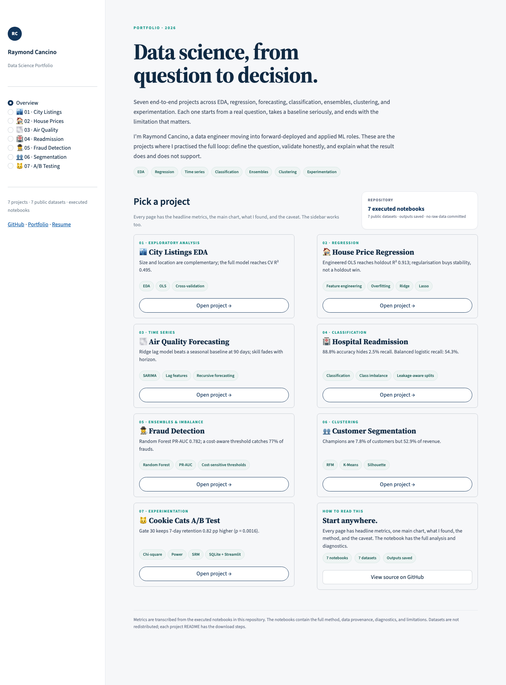

# Data Science Portfolio

[](https://cancinoray.netlify.app/)
[](https://data-science-portfolio-cancinoray.streamlit.app/)
[](https://drive.google.com/file/d/10nixZnwbBtAYzB-wXK0ZibS3YzUrPl-D/view)
[](https://www.linkedin.com/in/cancinoraymond/)
[](https://www.credly.com/badges/c7bfe8cd-3e7e-4c8d-a2c5-c533de00db49)

**Seven end-to-end data science projects** built across EDA, regression, time series, classification, ensembles, clustering, and experimentation. Each project starts from a real question, establishes a baseline, validates honestly, and ends with a plain-language answer and its limitations.

The work is grounded in a data-engineering background: building pipelines, reconciling schemas, and shipping fixes across e-commerce, AdTech, and EdTech. This repository focuses on the layer above that — modelling, evaluation, and communication.

- Live dashboard: https://data-science-portfolio-cancinoray.streamlit.app/
- Portfolio: https://cancinoray.netlify.app/
- Resume / CV: [view on Google Drive](https://drive.google.com/file/d/10nixZnwbBtAYzB-wXK0ZibS3YzUrPl-D/view)
- Email: cancinoray@gmail.com · LinkedIn: [/in/cancinoraymond](https://www.linkedin.com/in/cancinoraymond/) · GitHub: [@cancinoray](https://github.com/cancinoray)

**Start here:** [05 fraud detection](./05-ensembles-fraud-detection/) for metric judgement under imbalance, [07 A/B testing](./07-experimentation-ab-testing/) for experiment discipline, and [06 customer segmentation](./06-clustering-customer-segmentation/) for turning clusters into decisions. Every notebook opens with a TL;DR if you want the short version.

**Prefer a visual tour?** Open the [live dashboard](https://data-science-portfolio-cancinoray.streamlit.app/) or run `streamlit run dashboard/app.py` locally.

## Selected results

| # | Project | What I found | Skills |
|---|---|---|---|
| 01 | [City Listings EDA](./01-eda-city-listings/) | Size and location are complementary; full model CV R² **0.495**. Location adds +0.175 R² over size + room type; size adds +0.115 over location + room type. | EDA, OLS on log price, cross-validation |
| 02 | [House Price Regression](./02-regression-house-prices/) | Engineered OLS holdout R² **0.913**, RMSE **$22,788**. Ridge/Lasso cut CV log-RMSE from 0.163 to 0.140/0.138 but did not win the holdout. | Feature engineering, overfitting, Ridge, Lasso |
| 03 | [Air Quality Time Series](./03-time-series-air-quality/) | Ridge lag model **6.45 µg/m³** at 90 days vs 7.08 for a static seasonal baseline; **5.42** one step ahead. Skill fades with horizon. | SARIMA, lag features, recursive forecasting |
| 04 | [Hospital Readmission](./04-classification-hospital-readmission/) | 88.8% accuracy but only **2.5% recall** unweighted; balanced logistic recall **54.3%**, ROC-AUC **0.667**. Prior admissions dominate. | Classification, class imbalance, leakage-aware splitting |
| 05 | [Fraud Detection](./05-ensembles-fraud-detection/) | Random Forest PR-AUC **0.782** vs logistic 0.723 (ROC 0.935 vs 0.977). Cost-optimal threshold catches **77%** of frauds. | Ensembles, PR-AUC, cost-sensitive thresholds |
| 06 | [Customer Segmentation](./06-clustering-customer-segmentation/) | Five RFM segments; **Champions = 7.8% of customers but 52.9% of revenue**. Log-RFM clustering beats a raw-RFM outlier split. | RFM, K-Means, silhouette, segment naming |
| 07 | [A/B Testing](./07-experimentation-ab-testing/) | 7-day retention **19.02% vs 18.20%** (+0.82 pp, p = 0.0016); 1-day not significant. Keep the gate at 30. | Chi-square, power, SRM, SQLite, Streamlit |

Each project folder has its own `README.md` with the data source, licence, download steps, full
results, and skills shown. The notebooks are executed with their outputs saved, so the charts and
metrics render on GitHub without running anything.

## What this repo demonstrates

- **Baseline-first evaluation.** Every project compares against a simple, defensible baseline and
  reports errors in the units that matter — dollars, µg/m³, patients, transactions, percentage
  points — not just a leaderboard score.
- **Validation that respects the data.** Grouped patient splits prevent leakage; fraud and air
  quality use chronological splits; fraud thresholds are chosen on validation and evaluated once on
  test. Where the task is imbalanced (04, 05), I report precision/recall and use class weights
  instead of hiding behind accuracy.
- **Communication over jargon.** Each notebook explains what the metric does and does not imply,
  names the limitations, and translates the result into a decision a non-specialist can act on.

## About the work

These projects are original work built after completing WorldQuant University's **Applied Data Science Lab** in 2026 ([verify on Credly](https://www.credly.com/badges/c7bfe8cd-3e7e-4c8d-a2c5-c533de00db49)). WQU's academic policy doesn't allow sharing or reusing coursework, so this repo is a from-scratch demonstration of the same workflow: my own questions, code, and writing on public datasets. No coursework assignments, text, code, or proprietary datasets are reused here.

## What is inside each notebook

All seven notebooks are self-contained and reproducible.

Each notebook includes:

- a **TL;DR** with the headline numbers;
- the **question and why it matters**, in my own words;
- **data provenance** and licence, with exact download steps;
- **cleaning as decisions**, including what each filter costs;
- **EDA with interpretation** — every chart says what to look for and what it means;
- a **baseline, then an improved model**, with the reasoning for each;
- **metrics explained in plain language**, including what they do and do not imply;
- **limitations and next steps** that are specific to the dataset;
- a short **reference list**.

## How to run

```bash
pip install -r requirements.txt
jupyter notebook
# open any 0X-*/notebook.ipynb
```

Or open the unified portfolio dashboard:

```bash
streamlit run dashboard/app.py
```

The live app is at
[data-science-portfolio-cancinoray.streamlit.app](https://data-science-portfolio-cancinoray.streamlit.app/).
To deploy your own copy, use **`dashboard/app.py`** as the main file path. The app needs no
secrets or data files; it reads the summary results committed with the notebooks.

Datasets are **not committed**; download them into that project's `data/` folder (git-ignored)
following its README.

The A/B testing project also ships a dedicated dashboard:

```bash
cd 07-experimentation-ab-testing
jupyter notebook notebook.ipynb   # builds data/cookie_cats.db
streamlit run app.py
```



*The portfolio dashboard: seven projects, one interface.*

## Structure

- `templates/`: blank notebook + project README templates
- `01-...` through `07-...`: notebook projects (each: `README.md`, `notebook.ipynb`, `data/.gitkeep`)
- [`dashboard/`](./dashboard/): unified Streamlit portfolio dashboard (overview + one page per project)
- [`07-experimentation-ab-testing/app.py`](./07-experimentation-ab-testing/app.py): Streamlit dashboard for the A/B test
- `assets/portfolio_dashboard.png`: screenshot used above
- [volatility-garch-pipeline](https://github.com/cancinoray/volatility-garch-pipeline): separate repo, in progress (GARCH volatility, tests, packaging)

## Data and reproducibility notes

- All datasets are **public** but are not redistributed here. Each project README has the exact source,
  licence note, and download command.
- Sources: 01 (Inside Airbnb), 04 and 06 (UCI) download directly from their publishers; 03
  uses the Open-Meteo air-quality API; 02, 05, and 07 use documented public mirrors (OpenML or
  GitHub) so they can be reproduced without a Kaggle account.
- Notebook runs are deterministic where it matters: all splits and models use fixed random seeds.
- Expected runtimes: 01 ≈ 20–40s, 02 ≈ 30–60s, 03 ≈ 50–70s, 04 ≈ 30–60s, 05 ≈ 1–2 min,
  06 ≈ 60–90s (Excel read dominates), 07 ≈ 10s. Times are for a laptop.

## Stack

Python · pandas · NumPy · scikit-learn · statsmodels · SciPy · matplotlib · Streamlit · SQLite ·
Jupyter

---

For work history, credentials, and the full skill set, see the [portfolio](https://cancinoray.netlify.app/), [resume](https://drive.google.com/file/d/10nixZnwbBtAYzB-wXK0ZibS3YzUrPl-D/view), or [email me](mailto:cancinoray@gmail.com). Last updated November 2026.
