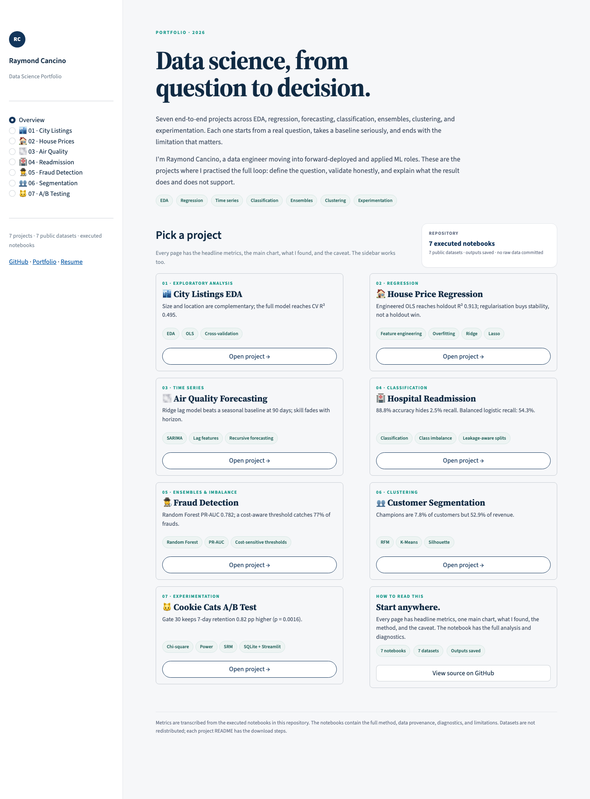

# Portfolio dashboard

A single Streamlit app that summarises all seven projects: headline metrics, one interactive chart
per project, the key findings, the method, the caveat, and links back to the notebook and README.



## Run

From the repository root:

```bash
pip install -r requirements.txt
streamlit run dashboard/app.py
```

The theme lives in `.streamlit/config.toml` at the repo root, so run the command from the root (not
from inside `dashboard/`).

## What it reads

The dashboard **does not read the raw datasets**. It uses the results already produced by the
executed notebooks and committed with them. That makes it deployable without committing 150+ MB of
data, and it keeps the dashboard fast.

Each project page links to the full notebook for the method, diagnostics, and limitations. If you
change an analysis, update the corresponding metrics in `dashboard/app.py` and the notebook together.

## Structure

- `app.py` — page config, design tokens, project data, Altair charts, routing.
- Pages: Overview, plus 01–07.
- Navigation: sidebar, project cards, and previous/next buttons.
- Links: notebook, project README, repository.

## Add a project

1. Add an entry to `PROJECTS` with metrics, findings, method, caveat, and links.
2. Add a `chart_*` function and register it in `CHARTS`.
3. `NAV_OPTIONS` and routing update automatically from `PROJECTS`.
